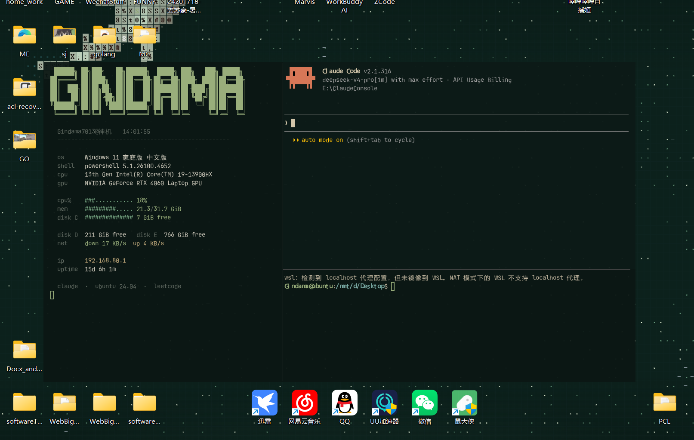

# DeskTop



> A terminal-first Windows desktop: one WezTerm window pinned **above the wallpaper, below every other window** — HUD, AI chat, LeetCode stats, tasks and a pomodoro timer, all in terminal tabs.

[](LICENSE)


```
 ┌ tab 1 ────────────────┬ tab 2 ───────────────────────┬ tab 3 ────────────────┐
 │   spinning donut      │  GINDAMA HUD  │ Claude Code  │  todo (fzf) │ pomodoro│
 │   LeetCode stats      │               │ Ubuntu (WSL) │             │ 25:00   │
 └───────────────────────┴───────────────┴──────────────┴─────────────┴─────────┘
```

## Why

Most "terminal desktops" replace the whole desktop. This one doesn't: it keeps your wallpaper,
icons and taskbar, and only pins a single frameless terminal to the bottom of the **normal**
z-order. It sits above the wallpaper, never covers your apps, and still accepts keyboard input
normally.

## Features

| Tab | What's inside |
|-----|---------------|
| 1 | Spinning ASCII donut (donut.c math, Python) + [LeetCode CN](https://leetcode.cn) stats |
| 2 | System HUD (uptime / CPU / RAM / disks / network), Claude Code, Ubuntu WSL shell |
| 3 | Task list driven by [`fzf`](https://github.com/junegunn/fzf) + pomodoro timer with presets |

- **Pinned, not always-on-top** — `SetWindowPos(HWND_BOTTOM)` in a loop keeps it above the
  wallpaper and below every app, without stealing focus.
- **Fixed geometry** — position lives in `layout.txt`, enforced with move-only calls (resizing a
  live WezTerm window can panic its renderer, so the size comes from the WezTerm config).
- **Tabs without a tab bar** — `Alt+←/→` to flip, `Alt+1..3` to jump.
- **Real tools, not reimplementations** — LeetCode GraphQL, `fzf`, `donut.c`, WSL, Claude Code.

## Requirements

- Windows 11
- [WezTerm](https://wezterm.org) (portable build works)
- PowerShell 5.1+
- Python 3 (for the donut)
- WSL with Ubuntu (optional, for tab 2's shell)
- `fzf` (optional, for tab 3) — `winget install junegunn.fzf`
- Claude Code (optional) — `npm i -g @anthropic-ai/claude-code`

## Install

```powershell
git clone https://github.com/Gindama713/DeskTop.git
cd DeskTop
powershell -ExecutionPolicy Bypass -File .\install.ps1
```

`install.ps1` will:

1. rewrite the `LOCAL` path in `wezterm.lua` to your clone directory,
2. back up any existing `~/.wezterm.lua` and copy the new one,
3. create `layout.txt` with the window geometry,
4. register a Startup shortcut that launches the terminal + pin watchdog.

Then edit `layout.txt` (or drag/resize the window once and copy the numbers from
`GetWindowRect`) to place it where you want.

## Configure

| File | Purpose |
|------|---------|
| `wezterm.lua` | font, colors, tab layout — the `LOCAL` variable at the top points at this folder |
| `layout.txt` | window `X` / `Y` on screen (virtual pixels) |
| `TODO.md` | tasks, `- [ ]` / `- [x]` |
| `leetcode-user.txt` | your LeetCode CN username |

LeetCode contest / activity / recent-submission data needs a `leetcode-cookie.txt` with your
`csrftoken` and `LEETCODE_SESSION` (never committed — it's in `.gitignore`). Without it the panel
still shows solved counts and the daily challenge.

## Memory footprint

Measured on Windows 11 24H2, idle after warm-up (working set):

| Component | RAM |
|---|---|
| WezTerm | ~135 MB |
| Claude Code | ~207 MB |
| 4 PowerShell panes (HUD / LeetCode / TODO / pomodoro) | ~350–440 MB |
| `deskpin.exe` — native z-order watchdog | ~25–70 MB |
| fzf + Python donut | ~23 MB |
| WSL2 VM, idle | ~65 MB |
| **Total, without wallpaper** | **~0.9 GB** |
| Lively wallpaper (optional) | ~148 MB |

Three things keep it from ballooning:

1. **No PowerShell pin loop.** The original watchdog cost ~91 MB; `deskpin.exe` (`DeskPin.cs`, compiled by the installer) does the same work in ~25 MB.
2. **Panes exit with the terminal.** Every pane script checks `Get-Process wezterm-gui` on each loop and quits — zombie panes can't pile up. That was the biggest real leak: duplicate panes doubled memory after a few restarts.
3. **No WMI polling on the hot path.** The HUD reads memory with a one-time compiled `GlobalMemoryStatusEx` P/Invoke instead of a per-second CIM query (the CIM version measured ~150 MB, the P/Invoke one ~90 MB).

To go lower: close the LeetCode pane, run the pomodoro on demand, use a static wallpaper — roughly 350 MB without Claude Code.
## Keys

| Keys | Action |
|------|--------|
| `Alt+←` / `Alt+→` | previous / next tab |
| `Alt+1..3` | jump to tab |
| `Alt+T` / `Alt+W` | new / close tab |
| tab 3 | `Enter` toggle task, `Ctrl-N` add, `Ctrl-D` delete, `Esc` quit |
| pomodoro | `space` start/pause, `1..5` presets, `r` reset, `q` quit |

## How the pinning works

```powershell
[Win32]::SetWindowPos($hwnd, [IntPtr]1, 0,0,0,0, 0x0013)  # HWND_BOTTOM | NOSIZE | NOMOVE | NOACTIVATE
```

`HWND_BOTTOM` puts the window at the end of the normal z-order: above the desktop wallpaper,
below every regular window. `NOACTIVATE` keeps your focused app focused. A background PowerShell
loop re-applies it every 500 ms so the window never drifts up.

## Troubleshooting

| Symptom | Cause / fix |
|---|---|
| WezTerm crashes with `Viewport dimensions are too large` | do not resize a live window with `SetWindowPos`; set size via `initial_cols/rows` |
| Window jumps back to a corner | `pin-terminal.ps1` enforces `layout.txt` every 500 ms |
| LeetCode panel says `unranked` / `no data` | cookie expired, paste a fresh one into `leetcode-cookie.txt` |
| Chinese shows as `????` in fzf | the script forces `chcp 65001`; keep it at the top |

## Project layout

```
wezterm.lua          WezTerm config (tabs, colors, spawn commands)
hud.ps1              left HUD pane
donut.py             spinning donut
leetcode.ps1         LeetCode CN panel
todo-fzf.ps1         task list via fzf
pomodoro.ps1         pomodoro timer
pin-terminal.ps1     z-order pin + position enforcement
layout.txt           window X/Y
start-terminal.cmd   launcher (generated by install.ps1)
wallpaper/           optional HTML wallpaper
```

## License

MIT — see [LICENSE](LICENSE). Star it if you build your own.
